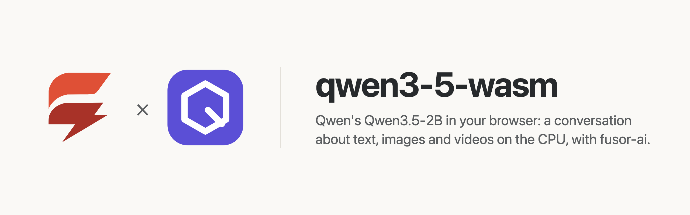
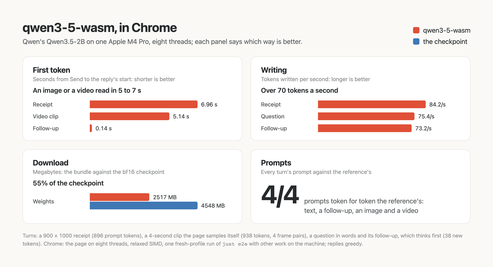

<p>
  <picture>
    <source media="(prefers-color-scheme: dark)" srcset="assets/brand/banner-dark.png">
    
  </picture>
</p>

# A conversation about text, images and videos in the browser, on the CPU

Talk to Qwen's [Qwen3.5-2B](https://huggingface.co/Qwen/Qwen3.5-2B), show it images and videos, let it think first if you like, and read each reply as it is written, computed on your own device. No server, no API key, no GPU required, and once the model has loaded, nothing you type or show leaves the page.

qwen3-5-wasm is the app around the model: a [fusor](https://github.com/fusor-rs/fusor) page, the browser runtime and a native CLI. The model itself, compiled to WebAssembly, is built with [fusor-ai](https://github.com/fusor-rs/fusor-ai), the toolkit for AI runtimes in Rust and WebAssembly, from the published weights.

**In development · v0.1**: this is experimental software. See [status and known limitations](#status-and-known-limitations).

[Run it](#run-it-locally) · [How it works](#how-it-works) · [How fast is it](#how-fast-is-it) · [Status](#status-and-known-limitations)

## Run it locally

You need Rust 1.99 or newer, installed with [rustup](https://rustup.rs), Node.js 22 or newer and [`just`](https://github.com/casey/just). Then:

```sh
git clone --recurse-submodules https://github.com/fusor-rs/qwen3-5-wasm && cd qwen3-5-wasm
just ui
```

and open the address it prints. `just ui` installs the pinned tools (the threads toolchain with rustup; wasm-bindgen, binaryen and the fusor CLI into `.tools/`), downloads the checkpoint at a pinned revision (4.5 GB, each file sha256-checked), compiles it into a 2517 MB bundle, builds the four browser runtimes (a few minutes the first time, seconds after) and the page, and serves it on `http://localhost:8787` with the bundle beside it.

Write a message, or start from an example (a receipt, a short video clip, a question in words), add images and videos by dropping, pasting or choosing them, and press **Send**, even while the model is still loading: the message is replied to the moment the model is ready. The reply streams in, its Markdown drawn; with **Think before replying** the model reasons first, and its reasoning folds away once the answer starts. Every later message continues the same conversation until **New conversation**. **Sampling** takes the model card's settings for each turn (they differ with thinking and with images or videos) or your own temperature, top-p, top-k and presence penalty, and the longest reply. Every reply is measured live: the time from Send to its first token, the tokens written per second, the conversation's tokens and those the turn read, and the network requests since the model loaded, which stay at zero.

## More ways to run it

### Build everything from source

```sh
just build    # also downloads the checkpoint (4.5 GB, sha256-checked) and compiles the bundle
just serve
```

`CHECKPOINT=<dir>` reuses a checkpoint you already have.

### The CLI

The CLI holds the conversations of a JSON file without a browser, turn by turn, each turn's images' paths relative to `--media` and each video read as the frames `just media` extracts beside it:

```sh
target/release/qwen3-5 chat dist/model fixtures/conversations.json --media fixtures/media
```

`qwen3-5 bench` measures each stage on a conversation's first turn and `qwen3-5 parity` compares every stage with the reference's outputs.

## How it works

- **The reference's prompt, token for token.** Each turn's prompt is the whole conversation as the model's chat template writes it: images' and videos' placeholders expanded as the processor expands them, each earlier reply written back without its reasoning, and the reply's opener with its thinking block open or empty.
- **A conversation read once.** Qwen3.5's 24 layers mix tokens two ways: every fourth with gated attention over a cache, the others with the gated delta rule, a linear attention whose state is the sum of everything read before. The state is saved where each reply starts; since the template writes a reply back differently from how it was generated, the next turn goes back to that point and reads only the last reply as written back and its own message, never the conversation again.
- **Images and videos as the model sees them.** An image is resized to whole 32-pixel blocks within 1.6 megapixels and cut into 16 × 16 patches of two frames, its own twice; a video is sampled at 2 frames a second (4 to 32 over its whole length), its frames sized together within a budget as the processor sizes them, each two frames one patch's two. A NaViT encoder reads each image and each frame pair, and a merger turns every 2 × 2 patches into one of the language model's tokens, placed by its row and column.
- **Videos decoded on the page.** The page samples a video itself, seeking its frames with the browser's own decoder at the frame rate it measures, so any video the browser plays can be shown to the model.
- **Sampled as the model card says.** Each turn draws its tokens with the model card's temperature, top-p, top-k and presence penalty for its mode, from a seed the page draws; a temperature of 0 replies greedily, as the checks do.
- **Quantized where it holds.** Every large matrix is 7-bit, 2517 MB against the 4.5 GB checkpoint. 4-bit feed-forwards would save 450 MB but move the language model's states five times as far from the reference's, which a reply carries from token to token. The multi-token-prediction layer, which only drafts tokens for speculative decoding, is left out, as the reference leaves it.
- **One stage per step.** The engine worker replies in steps (each image and each frame pair through the vision tower, the prompt, then each token) and posts each, so the reply streams and Stop takes effect between steps.
- **Threads and SIMD where the browser has them.** The page picks one of four builds: worker threads when it is cross-origin isolated, relaxed SIMD when the engine supports it, plain SIMD128 everywhere else.
- **Downloaded once, verified always.** The bundle streams in parts, each checked against its BLAKE3 hash, and stays in the browser's origin-private storage, so the next visit loads from this device in a few seconds.
- **Sealed.** The runtime imports no network, storage, clock or entropy capability; fusor-ai's import check proves it on every build. The page counts its network requests while it replies, and the count is zero.

## How fast is it

On an Apple M4 Pro in Chrome on eight threads, a turn about a 900 × 1000 receipt (896 prompt tokens, the image's included) starts its reply in 7.0 s and writes 84 tokens a second; one about a 4-second clip (938 tokens, 4 frame pairs) answers in 5.1 s; a follow-up in the same conversation starts in 0.14 s, reading only its 38 new tokens. Every fixed reply states the facts it is asked for, and greedy replies repeat the reference's word for word until a near tie:

<picture>
  <source media="(prefers-color-scheme: dark)" srcset="assets/benchmarks/benchmarks-dark.png">
  
</picture>

These are the figures of one `just e2e` run (`web-threaded-relaxed`, a fresh profile, other work on the machine); `just bench` breaks a turn down by stage natively.

## Documentation

| Guide | Covers |
| --- | --- |
| [AGENTS.md](AGENTS.md) | The code standard every change follows |

## Status and known limitations

qwen3-5-wasm is v0.1 and experimental.

| Platform or capability | Status |
| --- | --- |
| Chrome and Edge, threads and relaxed SIMD | Headless Chrome end-to-end check (`just e2e`): send while loading, a conversation with a thinking turn, an image, a video the page samples itself, revisit |
| Browsers without relaxed SIMD (Safari, older Firefox) | SIMD128 builds, checked in Node (`just smoke`); not tested in those browsers |
| Pages without cross-origin isolation | Single-threaded builds |
| Native CLI (macOS on Apple silicon) | Built and measured; no release archives yet |
| Phones | Not measured; the threaded builds' memory may grow to 4 GB |

**Not supported yet:**

- Conversations longer than 16,384 tokens, the media's included: start a new one. A reply is at most 8,192 tokens.
- Images above 1.6 megapixels are read at 1.6 (the checkpoint takes up to 16.8), and a video's frames within 6.4 megapixels together (the checkpoint takes 25.2), to keep a turn's tokens within reach of a CPU.
- A system prompt, tools and function calls, which the chat template supports.
- Speculative decoding with the checkpoint's multi-token-prediction layer.
- Videos in formats the browser cannot decode (Chrome has no MPEG-4 Part 2 decoder, for one): convert them first. A video's frame rate is measured from the frames the browser presents, so a variable rate is read as its fastest.
- A GPU backend.

The model is Qwen's [Qwen3.5-2B](https://huggingface.co/Qwen/Qwen3.5-2B), under the Apache-2.0 license; the bundle ships the license beside its weights (`model/LICENSE`). The example image and video are the [d3 model card](https://huggingface.co/vllm-sr/d3-nano)'s own (Apache-2.0), downloaded at a pinned revision; the video is also shipped as a lossless VP9 WebM the browser can decode.

## License

The code is licensed under the [MIT License](LICENSE). The model's weights are Qwen's, under [Apache-2.0](https://huggingface.co/Qwen/Qwen3.5-2B/blob/main/LICENSE).
